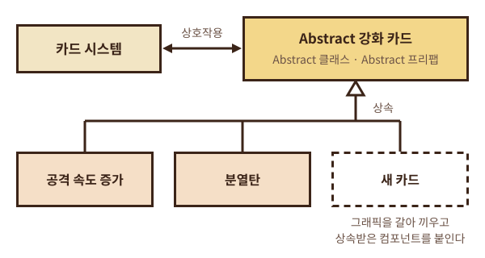
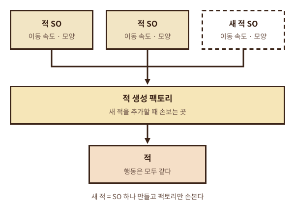
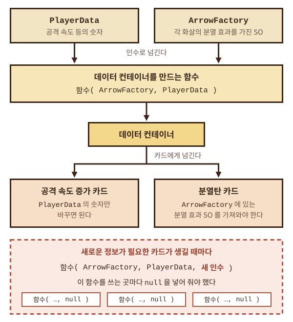

Emotive Play Lab 학부연구생으로 들어가 처음 시작한 프로젝트. 기획자 2명, 프로그래머 1명, 그래픽 1명이 작업했고, 프로그래밍 전반을 맡았다. 추상화와 패턴을 적극적으로 쓴 프로젝트다.

Google Play에 출시해 3개월간 서비스했다. 지금은 Google Play에서 내려갔고 App Store에만 남아 있다.

## 신경 쓴 점: 후임이 콘텐츠를 추가할 수 있는 구조

라이브 서비스를 목표로 한 프로젝트라서, 뒤를 이을 후임이 새 콘텐츠를 쉽게 만들 수 있게 하는 것이 목표였다. SOLID 원칙을 공부하고, 코드를 다 파악하지 않아도 기획 요구사항을 구현할 수 있게 만들었다.

인게임의 핵심 시스템은 강화 카드와 적 종류였고, 서로 다른 방법을 썼다. 아웃게임도 인게임 강화 카드와 똑같은 방법으로 만들었다.

### 강화 카드: Abstract 클래스 + 프리팹 상속

모양·상호작용은 같고 강화 로직만 다르다. 기본 Abstract 클래스를 만들고 프리팹 상속으로 구현하게 했다.

새 카드는 이렇게 추가한다.

1. Abstract 프리팹을 놓는다.
2. 엔진에서 그래픽을 갈아 끼운다.
3. Abstract 컴포넌트를 상속받은 컴포넌트를 붙인다.

이렇게만 하면 기존 카드 시스템과 완벽하게 상호작용한다. 부모 강화 카드가 강화에 필요한 스탯(체력, 공격력 등)을 인자로 받게 해서, 상속해서 인자만 조정하면 새 강화가 된다.

### 적: SO + 팩토리

행동은 모두 같고 이동 속도·모양만 다르다. 그래서 SO로 분리했다. SO 하나 만들고 적 생성 팩토리만 손보면 새 적이 추가된다.

### 결과

군입대 때문에 인수인계를 하지 못했다. 그래도 후임은 업데이트 2건을 무리 없이 진행했고, 보자마자 어떻게 작성해야 할지 파악할 수 있었다고 말해 줬다.

## 추가 경험

### 카드에 정보 넘겨주기

카드마다 필요한 정보가 전부 달랐다. 그 정보를 누가, 어떻게 가져와서 카드에게 넘겨줄지를 짜는 코드가 어려웠다.

| 카드 | 필요한 정보 |
| --- | --- |
| 공격 속도 증가 | `PlayerData` 인스턴스. 가져와서 그 안의 숫자만 바꾸면 됐다 |
| 분열탄 | 각 화살의 분열 효과를 가진 SO 인스턴스. `ArrowFactory` 에 있어서 거기서 가져와야 했다 |

그래서 데이터 컨테이너를 만들 때 `ArrowFactory` 와 `PlayerData` 를 인수로 넘겨받는 괴상한 함수를 만들었다. 새로운 인수가 필요해질 때마다, 그 함수를 쓰는 곳마다 `null` 을 넣어 주는 처리를 해야 했다.

- 이미 있는 정보를 조합하는 것은 쉬웠다.
- 새로운 정보를 추가하려고 하면 개발하기가 매우 어려웠다.

결국 이것 때문에 코어 시스템 중 하나라도 건드리면 전체를 바꿔야 하는 스파게티 코드가 됐다. 나중에 이 문제가 의존성 주입(DI) 관리라는 걸 알게 되는 계기가 됐다.

### 마일스톤으로 일정 관리

마일스톤을 정해서 일정을 관리했다.

### 아웃게임 저장: CSV 파서 직접 만들기

인게임 정보는 인게임 안에서만 유지되고 나오면 사라지지만, 아웃게임 정보는 저장되어야 한다. CSV로 저장했고, CSV 파서를 C#으로 직접 만들었다.

- **저장:** 특정 클래스를 for문으로 돌려서 CSV 파일로 만든다.
- **불러오기:** CSV를 읽어서 인스턴스 내용을 채워 넣고 반환한다.

이걸로 저장·불러오기를 구현해서 아웃게임 정보를 저장했다.

### 직접 출시하기

이전 게임의 Steam 출시는 기획자에게 맡겼지만, 이번에는 직접 Google Play에 올렸다. Unity SDK 버전업, 플레이 콘솔 요구사항 충족을 처리했고 Unity Ads·IAP로 BM을 붙였다.

SDK를 두 번 고친 뒤에야 출시할 수 있었다.

| 막힌 곳 | 원인 |
| --- | --- |
| 빌드가 안 됨 | 빌드에서는 쓸 수 없는 코드가 많았다 |
| 안드로이드에 설치하니 실행하자마자 튕김 | SDK가 호환되지 않았다 |
| 실기기 테스트 뒤 Play Store에 올리려니 또 걸림 | Play Store에도 맞춰야 하는 SDK가 따로 있었다 |

SDK를 고치는 것 자체는 쉬웠다. Android Studio에서 SDK를 내려받고 Unity 빌드 설정만 조금 바꾸면 됐다.
