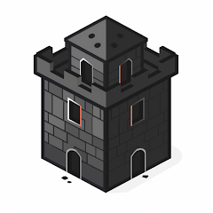

Emotive Play Lab 학부연구생으로 들어가 처음 시작한 프로젝트. 프로그래밍 전반을 맡았고 Google Play에 출시해 3개월간 서비스했다. 추상화와 패턴을 적극적으로 쓴 프로젝트다.

## 후임이 콘텐츠를 추가할 수 있는 구조

라이브 서비스를 목표로 한 프로젝트라서, 뒤를 이을 후임이 새 콘텐츠를 쉽게 만들 수 있게 하는 것이 목표였다. SOLID 원칙을 공부하고, 코드를 다 파악하지 않아도 기획 요구사항을 구현할 수 있게 만들었다.

핵심 시스템인 인게임 강화 카드와 적 종류는 둘 다 기본 Abstract 클래스를 만들고 프리팹 상속으로 구현하게 했다. 새 콘텐츠는 이렇게 추가한다.

1. Abstract 프리팹을 놓는다.
2. 엔진에서 그래픽을 갈아 끼운다.
3. Abstract 컴포넌트를 상속받은 컴포넌트를 붙인다.

이렇게만 하면 기존 카드 시스템과 완벽하게 상호작용한다.

- **적:** 행동은 모두 같고 이동 속도·모양만 다르다 → SO로 분리했다. SO 하나 만들고 적 생성 팩토리만 손보면 새 적이 추가된다.
- **강화 카드:** 모양·상호작용은 같고 강화 로직만 다르다 → 부모 강화 카드가 강화에 필요한 스탯(체력, 공격력 등)을 인자로 받게 했다. 상속해서 인자만 조정하면 새 강화가 된다.

## 막혔던 것: 카드에 정보 넘겨주기

카드마다 필요한 정보가 전부 달랐다. 그 정보를 누가, 어떻게 가져와서 카드에게 넘겨줄지를 짜는 코드가 어려웠다.

- 이미 있는 정보를 조합하는 것은 쉬웠다.
- 새로운 정보를 추가하려고 하면 개발하기가 매우 어려웠다.

결국 이것 때문에 코어 시스템 중 하나라도 건드리면 전체를 바꿔야 하는 스파게티 코드가 됐다. 나중에 이 문제가 의존성 주입(DI) 관리라는 걸 알게 되는 계기가 됐다.

## 직접 출시하기

이전 게임의 Steam 출시는 기획자에게 맡겼지만, 이번에는 직접 Google Play에 올렸다. Unity SDK 버전업, 플레이 콘솔 요구사항 충족을 처리했고 Unity Ads·IAP로 BM을 붙였다.

SDK를 두 번 고친 뒤에야 출시할 수 있었다.

| 막힌 곳 | 원인 |
| --- | --- |
| 빌드가 안 됨 | 빌드에서는 쓸 수 없는 코드가 많았다 |
| 안드로이드에 설치하니 실행하자마자 튕김 | SDK가 호환되지 않았다 |
| 실기기 테스트 뒤 Play Store에 올리려니 또 걸림 | Play Store에도 맞춰야 하는 SDK가 따로 있었다 |

SDK를 고치는 것 자체는 쉬웠다. Android Studio에서 SDK를 내려받고 Unity 빌드 설정만 조금 바꾸면 됐다.
