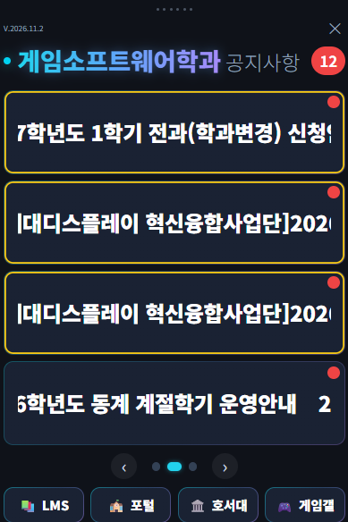

Emotive Play Lab에서 학과 대상으로 혼자 만든 서비스. 학생들이 공지사항을 잘 읽지 않는 문제를 해결하려고 시작했다. 복도 디스플레이와 실습실 컴퓨터에 띄울 위젯 앱을 만들었다.

## 구성

- **웹:** TypeScript + Tailwind CSS. DB는 Instant DB로 구독 과정을 단순화했다.
- **위젯 앱:** 만든 웹을 Electron으로 감싸고 위젯용 최적화, 자동 업데이트 등을 붙였다.

## 배운 것

어떤 언어·라이브러리·서비스를 고르느냐에 따라 구현 방향이 완전히 달라진다.

## 남은 일

- Instant DB가 구독 과정을 어떻게 단순화하는지 이해하기
