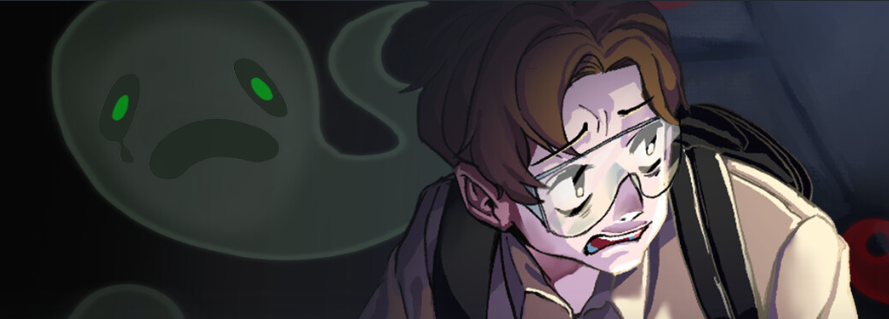

처음 만들고, 처음 출시한 탑다운 슈팅 게임. 기획자 1명, 프로그래머 1명, 그래픽 1명이 작업했다. 프로그래밍을 맡았고, 프로그래밍 자체도 이때 처음 해 봤다.

## 신경 쓴 점

### 전등

내가 보고 있는 방향 60도 안에 있는 적만 보인다. 다른 탑다운 슈팅 게임과 다른 점이다.

적이 그 60도 안에 있는지는 적과 나 사이의 각도를 내적으로 구해서 판정했다.

## 추가 경험

- 스파게티 코드를 처음 인지했다. 씬 전환, 하나만 바꿔도 모든 클래스를 고쳐야 하는 문제가 어렵다는 걸 알게 됐다.

## 배운 것

- 게임을 끝까지 완성하는 방법
- Steam에 무료 게임을 출시하는 과정
