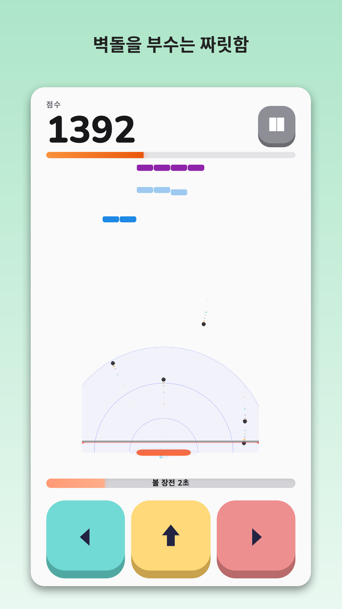
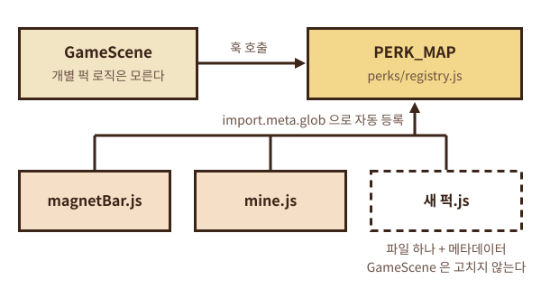
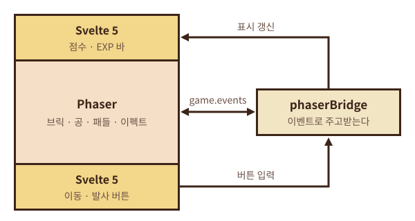

Emotive Play Lab에서 두 번째로 시작한 프로젝트. 1인 개발이고 Google Play와 App Store에 출시했다. 최신 업데이트를 끝으로 개발을 마쳤다. Claude Code로 바이브 코딩했고, 코드를 보면서 품질을 꾸준히 개선하는 일을 주로 했다. 구조 설계와 라이브러리 선택, 라이브러리 사이 통신 방식은 직접 정했다.

## 신경 쓴 점

### 콘텐츠 확장성을 위한 AI 코드 리팩토링

카드(퍽)와 업그레이드를 계속 추가해 나가는 게임이라, 새 콘텐츠를 쉽게 넣을 수 있는 구조가 필요했다. 그런데 Claude Code가 짠 코드는 퍽 22개의 효과가 `GameScene.js`(2,403줄) 곳곳에 흩어져 있었고, 영구 업그레이드 11개도 `GameScene` 이 한 덩어리로 불러 썼다. 퍽 하나를 추가하려면 `GameScene` 을 대여섯 군데 고쳐야 했고, 퍽이 늘수록 더 얽혔다. 화면 흔들림·번쩍임·파티클 같은 이펙트 코드도 6개 이상 파일에 똑같이 들어 있었다.

#### 퍽·업그레이드: 파일 하나씩 + 자동 등록

퍽과 업그레이드를 하나씩 파일로 나눴다 (Strategy 패턴). 퍽 파일은 `onBrickHit`, `onUpdate` 처럼 필요한 훅만 구현한다. 레지스트리가 Vite의 `import.meta.glob` 으로 폴더 안 파일을 모두 읽어 등록하고, `GameScene` 은 장착된 퍽의 훅을 차례로 부르기만 한다. 퍽 하나하나가 무엇을 하는지는 모른다.



```js
// perks/registry.js
const modules = import.meta.glob('./*.js', { eager: true });
const PERK_MAP = {};
for (const [path, mod] of Object.entries(modules)) {
  if (path === './registry.js' || path === './constants.js') continue;
  const perk = mod.default;
  if (perk && perk.id) PERK_MAP[perk.id] = perk;
}

// GameScene.js
_dispatchHook(hook, ...args) {
  for (const id of this._activePerks) {
    PERK_MAP[id]?.[hook]?.(this, ...args);
  }
}
```

새 퍽은 파일을 하나 만들고 메타데이터(이름·아이콘·등급)를 적으면 들어간다. 업그레이드도 같은 방식이다.

#### 이펙트: `fx` API 하나로

이펙트를 `src/effects/` 로 모았다. 씬마다 `this.fx = fx.bind(this)` 로 한 번 묶고 `this.fx.shake('heavy')` 처럼 부른다. 강도는 `micro` 부터 `extreme` 까지 5단계 프리셋을 한 파일에 두고, 필요한 값만 덮어쓴다.

#### 결과

`GameScene.js` 가 2,403줄에서 1,630줄로 줄었다. 나중에 추가한 카드 헤비 볼·지뢰는 `GameScene.js` 를 고치지 않고 퍽 파일과 메타데이터·아이콘·번역·테스트만 더해서 들어갔다.

### AI 퀄리티 한계를 넘기 위한 도전

#### UI: 여러 라이브러리 조합

처음에는 Phaser 하나로 게임 화면부터 메뉴·상점·덱·강화·설정·결과 화면까지 모두 캔버스에 그렸다. 버튼·카드 같은 UI 부품도 Phaser 위에 직접 만들어 썼다. UI와 애니메이션 표현이 부족했다. UI가 끊기거나 예상과 다르게 움직이는 문제도 손으로 다 잡을 수 없을 만큼 많았는데, 개별 버그가 아니라 구조 문제로 봤다. 씬 여러 개를 동시에 띄워 놓고 직접 멈추고 다시 켜야 했고, 씬끼리 입력이 겹치지 않게 가드를 둬야 했다.

UI 라이브러리를 조사해 괜찮아 보이는 것을 고르고, 교수님께 확인받은 뒤 넣었다. 글자와 레이아웃은 DOM이, 파티클과 실시간 그리기는 캔버스가 잘한다고 보고 경계를 나눴다.

| 라이브러리 | 맡은 일 |
| --- | --- |
| Phaser | 게임 플레이(브릭·공·패들), 파티클·화면 흔들림 같은 이펙트 |
| Svelte 5 | 메뉴 화면 전부, 인게임 글자 UI (점수·EXP 바·버튼·떠오르는 점수·배너) |
| Tailwind CSS | 화면 스타일 |
| GSAP | 숫자 카운트업, 카드 뒤집기 같은 UI 애니메이션 |

라이브러리 사이는 이벤트로 주고받게 했다.



- 저장은 `localStorage` 가 기준이고, Svelte 스토어는 그 값을 화면에 비추는 캐시로만 쓴다. 어느 쪽이든 값을 바꾸면 `game.events` 로 알리고, `phaserBridge` 가 받아 Svelte 스토어를 다시 읽는다.
- 인게임 버튼 입력도 `phaserBridge` 를 거쳐 Phaser로 간다.
- Phaser 인스턴스는 앱이 켜져 있는 동안 하나만 두고 지우지 않는다. 게임을 시작하면 캔버스를 위아래 Svelte 바 사이로 옮겨 게임 영역만 차지하게 했다.
- 옮길 때는 기존 화면과 애니메이션을 그대로 재현하는 것만 목표로 두고 디자인 개선은 뒤로 미뤘다. 화면 전환은 페이드 없이 슬라이드로만 했다.

Phaser에 등록된 씬이 14개에서 게임 씬 1개로 줄었다. Phaser로 그리던 메뉴 씬 12개(약 4,700줄)와 씬끼리 입력을 막던 가드는 지웠다. 인게임 글자 UI를 옮기면서 `GameScene.js` 는 1,713줄에서 1,528줄로 줄었다.

#### 아이콘: 직접 그린 스케치

피드백을 줘서 Claude Code가 아이콘 13종을 다시 그리게 했다. 그중 모멘텀·관통탄·플라즈마·인페르노 4종은 직접 스케치를 그려 Claude Code가 따라 그리게 했다. 새 카드 블리자드의 아이콘도 스케치를 따라 그리게 했다.

#### 검증: 문제를 짚어 장치로

문제가 보이면 그때그때 짚어서, Claude Code가 그 문제를 다시 잡아내는 장치를 만들게 했다.

| 영역 | 장치 |
| --- | --- |
| UI 겹침 | Playwright로 화면마다 요소 겹침 자동 검사 (강화 화면에서 겹침 버그 5건 발견) |
| 밸런스 | 봇이 실제 게임을 플레이해 투자 수준별 합격 기준 4가지를 판정하고 보고서로 저장 |
| 프레임 | 실기기 프레임 오버레이, 프레임이 튀는 순간을 잡는 측정 스크립트 |
| 로직 | 모든 로직 변경은 테스트 먼저 (TDD), 테스트 903개 |
| 문서 | 옛 기획·설계 문서 57개 삭제, 코드를 단일 진실로. 스펙은 코드에서 다시 뽑아 수치마다 코드 위치 표기 |

문서 쪽은 Claude Code가 옛 기획 문서를 보고 코드를 바꾸는 일이 생겨서 직접 정했다.

## 다른 언어로 개발해 보기

C 계열이 아닌 JavaScript와 Phaser처럼 처음 써 보는 언어와 라이브러리로 개발했다. 코드를 보면서 언어마다 핵심 철학(아키텍처, 프레임워크)이 다르다는 걸 알았다. 게임도 엔진 하나로 다 만들 필요 없이 여러 라이브러리를 조합해서 만들 수 있다는 것도 알게 됐다. 각각 장단점이 있으니 프로젝트에 맞는 언어·아키텍처·프레임워크를 골라야 하고, 그러려면 여러 가지를 알고 있어야 한다.

## AI 활용

Claude Code로 게임을 만들면서 경계가 보였다.

| 맡길 수 있음 | 맡기기 어려움 |
| --- | --- |
| 기획서 작성, 프로토타입 개발, 브레인스토밍, 자료 조사 | 재미 검증, 코드 구조 설계 |

## 추가 경험

- 튜토리얼을 이틀 동안 커밋 50개 넘게 만들고 고치다가 결국 통째로 지웠다.
- UI는 처음에 React로 옮기는 브랜치를 만들었지만 합치지 않았고, 2주 뒤 Svelte 5로 다시 옮겼다.
- 스토어 업로드와 심사 제출은 Claude Code에 스크립트를 만들게 해 자동화했다.
- App Store 심사에서 구매 복원 버튼 누락(3.1.1)과 ATT 팝업 미표시(2.1)로 거절돼, 둘 다 고쳐서 다시 냈다.
- Android 2026.6.2가 실행하자마자 꺼졌다. 빌드 캐시 문제로 AAB에서 `MainActivity` 가 빠져 있었고, 클린 빌드로 2026.6.3을 다시 냈다.
