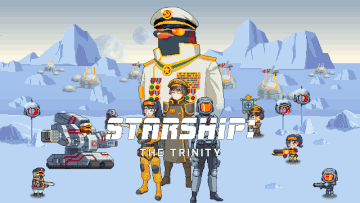
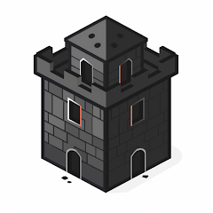
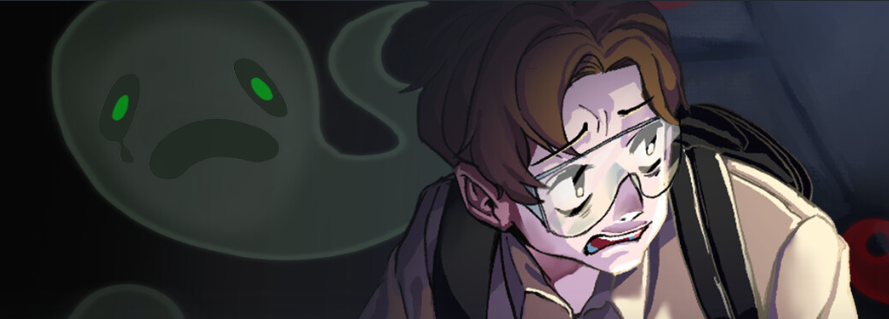

노션에 있던 포트폴리오를 이 사이트로 옮겼다. 앞으로 기술 일기를 쓰면 포트폴리오가 자동으로 정리되니까, 노션 내용을 프로젝트별로 한 번 정리해 두었다.

## 프로젝트

| 프로젝트 | 기간 | 역할 | 기술 |
| --- | --- | --- | --- |
| 퐁퐁샷 | 2026.3 ~ 진행 중 | 1인 개발 (Google Play·iOS 출시 예정) | JavaScript, Phaser, Claude Code |
| Project Arimu | 2025.6 ~ 2026.3 | 1인 개발 | Unity, R3, Unity Test Framework → Siv3D, EnTT |
| STARSHIP : THE TRINITY | 2025.7 ~ 2025.12 (하차) | 프레임워크(SO 기반)·시스템 개발 | Unity |
| Deadlands : idle defense | 2023.3 ~ 2023.12 | 프로그래밍 전반, Google Play 출시 후 3개월 서비스 | Unity |
| Exterminator | 2022.7 ~ 2022.8 | 프로그래밍, Steam 무료 출시 | Unity, C# |
| HSC Senior | 교내 창업 동아리 | 시니어용 앱·성과보고용 웹 | Kotlin |

### 퐁퐁샷 — AI에게 맡길 수 있는 것과 없는 것

Claude Code로 게임을 만들면서 경계가 보였다. 기획서 작성, 프로토타입, 브레인스토밍, 자료 조사는 맡길 수 있다. 재미 검증, 최적화, 코드 구조 설계는 맡기기 어렵다.

C 계열이 아닌 언어로 처음 개발하면서, 언어·아키텍처·프레임워크마다 장단점이 다르니 프로젝트에 맞는 걸 골라야 한다는 걸 알았다.

### Project Arimu — 객체지향에서 ECS로

- R3로 재사용 가능한 FSM 코드 에셋을 만들었다.
- [Haare Framework](https://github.com/kirihara-unity/HaareFramework)를 쓰면서 테스트했다. 에셋 로딩 중에 UI가 먼저 표시돼 빈 화면이 잠깐 보이는 결함 등을 찾아 수정을 제안했다. 이 과정에서 TDD를 실제 개발에 적용했다.
- Unity + 객체지향으로는 DI 문제 때문에 다양한 상성을 구현하기 어려웠다. Siv3D + EnTT로 다시 만들면서 ECS를 익혔고, 엔티티 간 상호작용을 더 유연하게 표현할 수 있게 됐다.

### STARSHIP : THE TRINITY — DI는 컴파일러가 안 잡아 준다

9명 이상의 팀에서 SO 기반 프레임워크를 맡았다. 컴파일 에러는 언어가 잡아 주지만 DI 누락은 아무도 잡아 주지 않는다. 직접 프레임워크로 해결하려다 실패했고, DI 라이브러리를 도입했다.

### Deadlands : idle defense — 후배가 이어받을 수 있는 코드

- 직접 Google Play에 올리면서 Unity SDK 버전업, 플레이 콘솔 요구사항, Unity Ads·IAP를 처리했다.
- 운영을 후배에게 넘길 걸 생각해서, 코드를 다 읽지 않아도 기획 요구사항을 넣을 수 있게 만들었다.
  - 적은 행동이 같고 속도·모양만 다르다 → SO로 분리. SO 하나 만들고 팩토리만 고치면 새 적이 추가된다.
  - 강화 카드는 모양·상호작용이 같고 로직만 다르다 → 부모 클래스가 스탯을 인자로 받게 하고, 상속해서 인자만 바꾸면 새 강화가 된다.

### Exterminator — 처음 완성하고 출시한 게임

게임을 끝까지 완성하는 방법과 Steam 무료 출시 과정을 경험했다.

### HSC Senior — 시니어 UX와 토큰 비용

- 시니어의 모바일 숙련도에 맞춰 UI 깊이를 줄이고, 주요 터치 범위 안에 상호작용 UI를 두고, TTS를 붙였다.
- AI 대화 앱에서 입출력·사고 토큰 상한과 프롬프트 엔지니어링으로 **토큰 사용량을 6배 줄였다.**
- 디지털 리터러시 → AI 친화로 사업 방향이 바뀌었다. MVVM과 UI 블록 에셋화를 미리 해 둬서 빠르게 대응할 수 있었다.

## 연구실 (Emotive Play Lab)

- **학과 공지사항 웹/앱**: TypeScript + Tailwind CSS로 웹을 만들고, Instant DB로 구독 과정을 단순화했다. 웹을 Electron으로 감싸 위젯 앱으로 만들고 자동 업데이트를 붙였다.
- **AI 이미지 생성 서비스**: 연구실 서버의 ComfyUI를 Tailscale Funnel로 공개했다. 오픈소스 프론트 OrangeUI에 다중 작업·분석 기능을 넣고, ComfyUI 앱 모드를 직접 렌더링해 프롬프트 입력의 한계를 보완했다.

## 막혔던 것: 맵 이동이 느림 (2026.07.16)

AIMA 프로젝트에서 맵을 이동할 때 너무 느렸다.

| 원인 | 해결 |
| --- | --- |
| 이동할 때마다 NavMesh를 베이크함 | 게임 시작 때 미리 베이크. 맵-NavMesh 버전을 json으로 매칭하고, 버전이 안 맞을 때만 다시 베이크 |
| 이동할 때 그제서야 맵을 로드함 | 포탈로 연결된 맵을 미리 로드하고, 연결되지 않은 맵은 언로드 |

다음에 해 볼 것: 베이크를 GPU로 넘기기, ECS로 CPU가 GPU 명령을 만드는 작업의 캐시 효율 올리기.

## 남은 일

- 프로젝트별 노트를 따로 쓰기 (지금은 이 글 하나에 몰려 있어서 포트폴리오의 프로젝트 칸이 비어 있다)
- 프레임이 안 나오는 문제 조사
- Instant DB가 구독 과정을 어떻게 단순화하는지 이해하기
