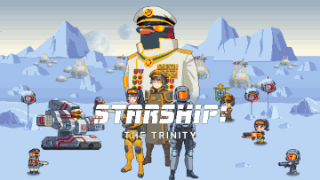

9명 이상의 팀원과 협업해 전시회·공모전에 도전한 게임. 2025.12에 하차했다.

## 맡은 일

- SO 기반 프레임워크 개발
- 시스템 개발

## 배운 것

객체지향에서 DI 관리는 컴파일만큼 까다롭다. 컴파일 에러는 언어가 잡아 주지만, DI가 빠진 건 아무도 알려 주지 않는다. 이걸 더 편하고 눈에 보이게 하려고 직접 프레임워크를 만들었지만 실패했고, 결국 DI 라이브러리를 찾아 도입했다.
